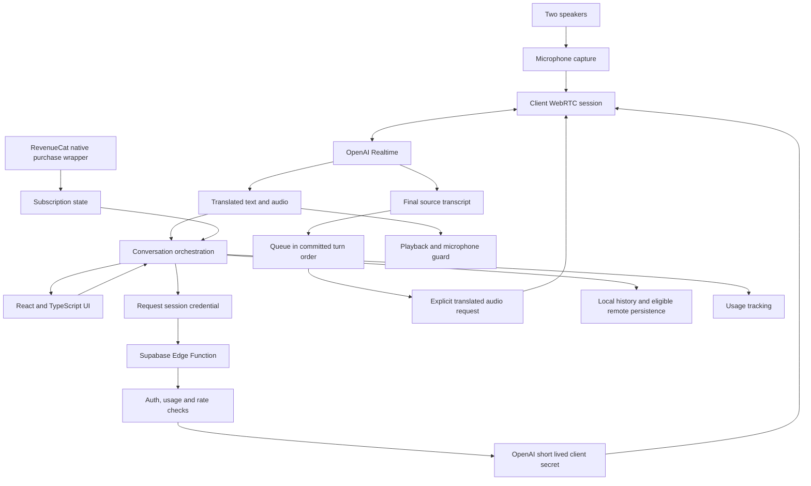

# Architecture

This describes the main shared microphone flow in the inspected source. A separate directed translation path exists, but session selection keeps the shared microphone on general Realtime for two way translation.

## Session setup

The client requests a short lived credential through a Supabase Edge Function. That function resolves the caller, checks usage access and rate limits, validates requested configuration, and uses a server environment secret to request the OpenAI client credential.

The client uses that credential to establish WebRTC. The server OpenAI key is not needed in this session setup on the client. This statement describes the Realtime credential flow, not a security audit of the entire product.

## Translation and source identity

For the main general Realtime path, automatic responses are disabled. Final source transcripts trigger explicit translated audio requests. Each request has isolated text input, translation instructions, and source item metadata.

The queue serializes translation requests and preserves committed speech order even if transcription completion order changes. Conversation identity helpers associate returned translations with their source entries.

## Playback and echo control

WebRTC capture requests echo cancellation, noise suppression, and gain control. Platform integrations configure communication audio modes while the microphone is active. A guard disables outgoing microphone tracks during translated playback and holds them briefly after playback ends.

This reduces the opportunity for the app to translate its own speaker output. It also means the conversation is intentionally turn based while translated audio plays.

## Accounts, subscriptions, and usage

Supabase supplies authentication and backend services. A native RevenueCat wrapper serializes identity changes and customer operations. Signed in purchase, restore, and entitlement operations synchronize the expected identity before proceeding.

Usage is represented locally and on the server. Paid usage reads and increments use server operations, with client ordering guards against stale responses. Receipt reconciliation and renewals have their own backend logic and tests in the private implementation.

## Delivery and verification

The private repository configures GitHub Actions to run lint, TypeScript checks, tests, and a web build. That workflow definition shows intended checks, not a claim that a particular remote run passed. The public sample has a separate test command and no production service dependencies.
