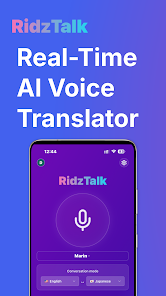
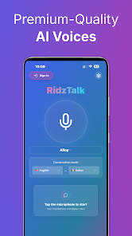

# RidzTalk

**A bilingual voice translation app, available on Google Play.**

RidzTalk helps two people speak across a language barrier: select two languages, speak into the microphone, read the transcript and translation, and hear the translated speech.

[Try RidzTalk on Google Play](https://play.google.com/store/apps/details?id=com.polytalk.app) · [Architecture](ARCHITECTURE.md) · [Engineering decisions](ENGINEERING.md) · [Run the code sample](code-sample/README.md) · [Evaluation plan](evaluation/README.md)

Android is publicly available. An iOS release is planned. The production application source is private because RidzTalk is a business project. This repository shares a technical case study and a focused source sample.

  
  

These are promotional images from the public Google Play listing, retrieved on 22 October 2026. They are not screenshots captured during an independent test. A continuous device demo is still to be recorded.

## Product and engineering scope

The application combines a React and TypeScript interface with Capacitor mobile projects, Supabase authentication and backend functions, OpenAI speech processing, RevenueCat subscription integration, and usage accounting.

The engineering work spans microphone capture, WebRTC session management, asynchronous transcript events, translated audio playback, conversation history, account changes, and paid access. OpenAI supplies the speech and language models. The application implements the surrounding product behavior and orchestration.

## A concrete engineering problem

Two people speak in order, but their final transcripts can arrive in the opposite order. Translating whichever transcript arrives first can reverse the conversation.

RidzTalk's translation queue reserves a position when each speech turn is committed, then fills that position when its transcript finishes. It sends the finalized source text as explicit translation input and carries its source identity into the response request. Empty, failed, and deleted turns release their positions.

The [TypeScript sample and regression tests](code-sample/README.md) reproduce this behavior without a microphone, API key, or access to the private app.

## What this project demonstrates

| Area | Evidence in this showcase |
| --- | --- |
| Application engineering | Mobile and backend architecture, asynchronous turn handling, account lifecycle decisions |
| AI application engineering | Explicit translation input, source identity tracking, speech feedback controls, evaluation design |
| Testing | Runnable tests covering transcript isolation, turn ordering, duplicate events, and error handling |
| Product delivery | Public Android listing, subscriptions and usage controls in the inspected implementation |

## Results and limits

The Android release can be inspected through the store link above. The source sample can be tested locally. Latency, translation quality, active users, and revenue are not reported here because no verified measurements are available for this case study.

The [evaluation plan](evaluation/README.md) defines how to collect speech quality, latency, reliability, and cost evidence. It is a proposed experiment, not a completed benchmark.

Live translation requires network services. Saved voice playback does not imply offline live translation. Microphone gating during translated speech intentionally limits interruption. Native audio and payment behavior require device testing beyond the isolated sample.

## Source and release context

This case study describes source inspected on 22 October 2026. It does not claim every implementation detail is present in the current store binary. The [Google Play listing](https://play.google.com/store/apps/details?id=com.polytalk.app) establishes Android availability; it does not establish language accuracy or performance.
